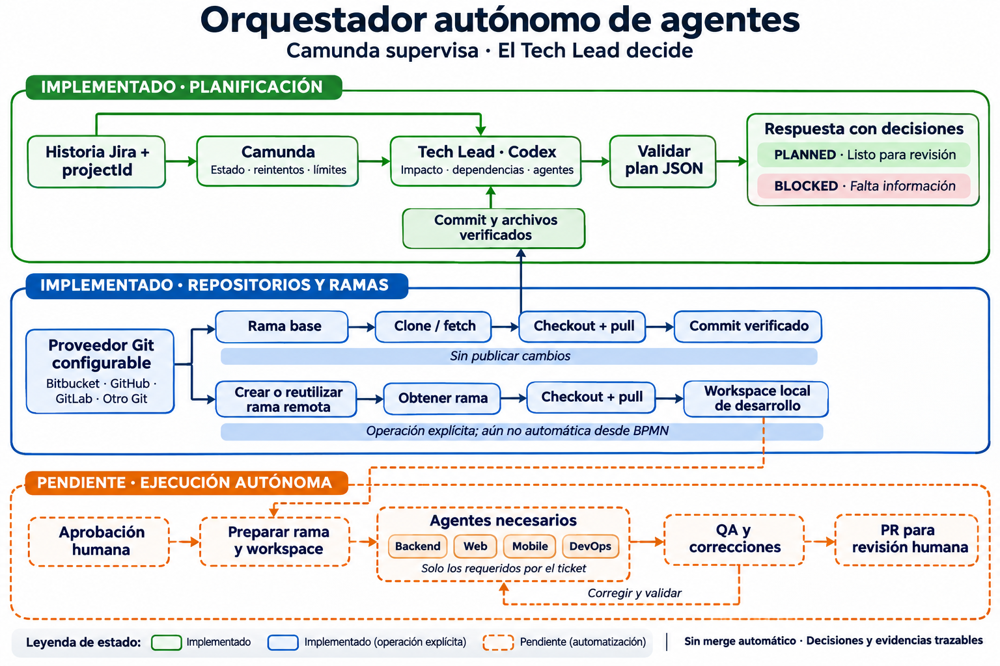
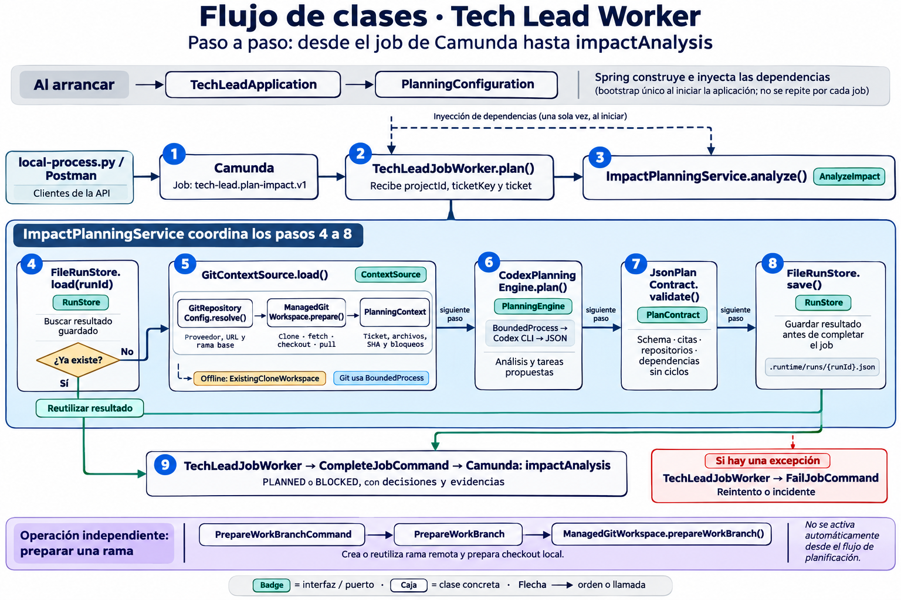

# Agents Orchestrator para Camunda

Worker compartido entre proyectos, con identidad Java `com.agents.orchestrator` y grupo Gradle `com.agents`. El proyecto se recibe explícitamente en `projectId`; se carga su perfil, patrón de tickets, repositorios y mapa de clones. El prompt de Codex recibe ese identificador dentro del contexto, sin una marca de proyecto fija. KIVNES es un caso configurado y una evidencia histórica de validación.

Implementación ejecutable de **solo lectura y planificación**. Lee una historia Jira, sincroniza repositorios Git del proveedor configurado e inspecciona commits locales, llama a Codex CLI y devuelve un análisis con evidencias y un plan dinámico. El proceso de planificación no desarrolla, crea ramas, abre PRs ni ejecuta QA. La preparación explícita de una rama para desarrollo se describe más abajo.

## Qué se encontró y qué se reutiliza

- El runtime local vive en este proyecto: `docker-compose.yml` levanta Camunda **8.10.9**, almacenamiento H2 persistente y el worker Java. La API local queda en `http://127.0.0.1:8088`. No se necesita PostgreSQL adicional para este MVP.
- Los dos BPMN solicitados eran copias idénticas, con el mismo process ID. El original ya tenía cambios del usuario: se conserva exactamente su contenido al comenzar esta tarea, sin restaurarlo desde Git.
- El proceso original lee Jira, clasifica repositorios explícitos, solicita revisión, crea ramas y recorre backend → web → mobile → QA → aprobación de PRs. Los tipos de trabajos representan contratos, no prueban que existan sus implementaciones.
- El JAR Java implementa los dos jobs del MVP: `ticket.read` y `tech-lead.plan-impact.v1`. No se encontraron workers para crear ramas, implementar componentes, QA ni PRs. El modelo está en `bpmn/` y la colección Postman en `postman/`. El proceso actual no contiene tareas humanas, por lo que no requiere formularios.
- `ticket.read` consulta Jira con las variables privadas `JIRA_BASE_URL`, `JIRA_EMAIL` y `JIRA_API_TOKEN`; valida el perfil en `projects/` y devuelve `ticket`. El antiguo worker Node ya no es necesario para este flujo.
- El clasificador anterior usa Responses API y exige una sección explícita de repositorios. No se usa en el nuevo proceso: la selección la hace el Tech Lead a partir del ticket y de evidencia del código.
- Se localizaron clones locales backend, web y mobile. El perfil declara backend `spring-boot-starter-backend`, pero el clone `crossfit-backend` tiene otro origin: **no se los considera equivalentes**. Se registra un bloqueo hasta corregir o confirmar la configuración.

## Arquitectura implementada

```text
Camunda: inicio → ticket.read (Java) → tech-lead.plan-impact.v1 (Java)
                                             ↓
              perfil → clone/fetch/checkout/pull → snapshot Git → Codex CLI → validación
                                                               ↓
                                                   archivo de resultado
                                                               ↓
                                               impactAnalysis en Camunda
                                                               ↓
                                          fin PLANNED o fin BLOCKED
```

El nuevo proceso tiene ID `implementar_feature_desde_tech_lead_agent_v1`. Su fuente está en `bpmn/agents-orchestrator.bpmn`; Gradle la empaqueta y `@Deployment` la despliega al iniciar el worker. Conserva el inicio, el trabajo Jira y la identidad de la tarea de análisis del BPMN copiado.

Camunda persiste el estado, los resultados y los incidentes, y supervisa reintentos y un límite total de **15 minutos** mediante un evento temporizador interruptivo. Si vence, finaliza por `End_Timeout`, sin producir un análisis exitoso. Revisar las actividades en Operate para distinguir ese fin de los otros.

Java implementa el caso de uso `AnalyzeImpact` mediante puertos sin Spring en `application/`. Spring configura los adapters. `PlanningEngine` permite cambiar Codex por otro motor sin modificar el BPMN. El MVP ejecuta un solo worker y no ofrece endpoints HTTP propios.

Se eligió un worker externo con el starter oficial **8.10.9**, Java **21** y Spring Boot **4.1.2**. Camunda 8.10 soporta AI Agent Sub-processes, pero no se necesita introducir un segundo runtime de razonamiento ni integrar Codex como proveedor de ese conector para este alcance. Los subprocesos ad hoc/MCP son una alternativa futura para herramientas dinámicas supervisadas por Camunda.

## Contratos

Entrada de proceso:

```json
{"projectId":"example-project","ticketKey":"EXAMPLE-123"}
```

`ticket.read` consulta Jira y aporta `ticket` con key, summary, description (ADF normalizado), status, issueType, priority, labels, components y url. Los criterios de aceptación se extraen de la descripción. Los campos personalizados de criterios no son consultados por el lector Java: extenderlo si el proyecto los necesita.

Salida de proceso: variable `impactAnalysis`.

- `status`: `PLANNED` o `BLOCKED`. Un bloqueo funcional completa el proceso con esa información; una falla técnica genera reintento/incidente.
- `affectedComponents`: impacto por componente. `affected: null` significa desconocido, **no ausencia de impacto**; true/false requieren evidencia. Un repositorio inaccesible se normaliza siempre a null.
- `facts`: afirmaciones con evidencia exacta; `inferences` y `decisions` separan hipótesis y propuestas.
- `tasks`: DAG con IDs únicos, dependencias existentes y sin ciclos. Los agentes se seleccionan dinámicamente y son propuestas, no trabajos ejecutados.
- `risks`, `blockers`, `requiredApprovals`, `acceptanceCriteria` y `recommendedNextAction` explican límites y siguientes pasos.
- `runId`: clave del job Camunda; `readOnly`, `engine` y `repositories` aportan trazabilidad, revisiones y cobertura de inspección.

Schemas versionados en `src/main/resources/`:

- `tech-lead-output.schema.json`: salida estricta solicitada al modelo.
- `impact-analysis.schema.json`: resultado final con metadatos de ejecución.

Se validan esquema, ticket, componentes, repositorios, revisión, archivo y presencia literal de la cita, además del DAG. Las citas prueban existencia del texto, no la corrección semántica de una conclusión: hace falta revisión humana. Los bloqueos observados por el servicio no pueden ser eliminados por el modelo.

## Configuración y ejecución

Desde esta carpeta:

```sh
export JAVA_HOME="$(/usr/libexec/java_home -v 21)"
export PATH="$JAVA_HOME/bin:$PATH"
./gradlew test bootJar
```

Las pruebas unitarias viven en `src/test/java`; las pruebas de integración de Spring, en `src/integrationTest/java`. Ejecutarlas por separado o junto con formato:

```sh
./gradlew integrationTest
./gradlew check
./gradlew pitest
```

`check` ejecuta pruebas unitarias, integración y Spotless. PIT genera sus reportes XML y HTML bajo `build/reports/pitest/`.

Se incluye Gradle Wrapper 9.3.1. La primera ejecución descarga Gradle y dependencias; requiere acceso a Internet.

Configurar el perfil del proyecto en `projects/` o indicar otro directorio con `CAMUNDA_PROJECTS_PATH`. `examples/projects/example-project.json` contiene una plantilla con repositorios en distintos proveedores. Cada repositorio declara `repository`, `baseBranch` y `cloneUrl`; puede sobreescribir `sourceControl.provider`. Los proveedores reconocidos son `bitbucket`, `github`, `gitlab` y `git` para otros servidores Git. La integración usa el protocolo Git, por lo que no necesita una API de cada proveedor para clonar ni crear ramas.

```json
{
  "projectId": "example-project",
  "sourceControl": {"provider": "bitbucket", "workspace": "example-team"},
  "repositories": {
    "backend": {
      "repository": "example-api",
      "cloneUrl": "git@bitbucket.org:example-team/example-api.git",
      "baseBranch": "main"
    },
    "web": {
      "repository": "example-web",
      "sourceControl": {"provider": "github"},
      "cloneUrl": "git@github.com:example-team/example-web.git",
      "baseBranch": "develop"
    }
  }
}
```

El extracto anterior muestra solo los campos de código fuente; conservar `ticketProvider`, `ticketKeyPattern`, `branchPattern` y `workflowStage` según la plantilla completa y el lector Jira existente. Para perfiles Bitbucket antiguos sin `cloneUrl`, se deriva `git@bitbucket.org:{workspace}/{repository}.git`; el nombre del repositorio sigue siendo el configurado, sin asumir equivalencias entre nombres distintos.

```sh
export CAMUNDA_PROJECTS_PATH=projects
export REPOSITORY_MODE=remote
export REPOSITORY_WORKSPACES_PATH=/ruta/privada/orchestrator-workspaces
export CODEX_EXECUTABLE=codex
```

El modo predeterminado es `remote`. No exige clones preexistentes ni un mapa de rutas. Autenticar Git por SSH con agente/llaves y host registrado en `known_hosts`, o usar HTTPS con un credential helper en un archivo privado indicado mediante `SOURCE_CONTROL_GIT_CONFIG`. Las URLs no admiten contraseñas, tokens ni parámetros de consulta. La configuración y las credenciales no se transmiten a Codex.

El modo anterior queda disponible explícitamente con `REPOSITORY_MODE=local-snapshot` y `REPOSITORY_PATHS_FILE`. En ese modo offline se usan `repository-paths.example.json` o el ejemplo separado `repository-paths.kivnes.example.json`; no hay sincronización remota y puede haber desfase.

Opcionalmente guardar estos valores en un archivo privado y establecer `TECH_LEAD_ENV_FILE=/ruta/runtime.env`; ver `runtime.env.example`. No se transmiten rutas ni credenciales como variables BPMN.

1. Copiar `camunda/worker.env.example` a `camunda/worker.env` y completar las credenciales privadas de Jira. No versionar ese archivo.
2. Iniciar todo desde esta carpeta:

```sh
docker compose up --build
```

3. En el primer uso, autenticar Codex dentro del contenedor: `docker compose exec worker codex login`.
4. El worker despliega automáticamente el BPMN empaquetado. Iniciar e inspeccionar una instancia con el cliente Java:

```sh
./gradlew localProcess -PcommandArgs="start --project kivnes --ticket KIVNES-34"
./gradlew localProcess -PcommandArgs="inspect --instance CLAVE_DEVUELTA_POR_START"
```

La petición de inicio espera por defecto el análisis y devuelve las decisiones en `variables.impactAnalysis`:

```http
POST http://localhost:8088/v2/process-instances
Content-Type: application/json
```

```json
{
  "processDefinitionId": "implementar_feature_desde_tech_lead_agent_v1",
  "awaitCompletion": true,
  "requestTimeout": 600000,
  "fetchVariables": ["impactAnalysis"],
  "variables": {"projectId": "kivnes", "ticketKey": "KIVNES-34"}
}
```

La respuesta HTTP 200 incluye `processInstanceKey` y `variables.impactAnalysis`, con resumen del ticket, componentes afectados, decisiones, tareas y agentes propuestos, dependencias, bloqueos y siguiente acción. El resultado representa planificación: las tareas no se ejecutan en este MVP. `BLOCKED` también devuelve el análisis para explicar qué impide continuar.

El servidor espera hasta 600.000 ms (10 minutos); el cliente Java usa un timeout de 630.000 ms. Si la petición recibe HTTP 504, la instancia puede continuar ejecutándose: no iniciar otra automáticamente porque duplicaría análisis y consumo. Revisar Operate. Si el proceso termina por su temporizador sin `impactAnalysis`, el cliente informa error en lugar de presentar una respuesta incompleta como éxito.

Para conservar el inicio inmediato y consultar después, usar `./gradlew localProcess -PcommandArgs="start --project kivnes --ticket KIVNES-34 --async"`.

En el cliente Java, `start` exige `--project`: no existe un proyecto predeterminado. En Postman configurar `project_id` y `ticket_key` antes de enviar la petición; ambos están vacíos para impedir una selección implícita.

El cliente Java solo acepta un Camunda local. `inspect` puede no ver un resultado inmediatamente por la consistencia eventual; repetir después. No declarar éxito si falta `impactAnalysis`, el proceso tiene incidente o salió por timeout. La colección `postman/tech-lead.postman_collection.json` espera las decisiones y valida el contenido de `impactAnalysis`, además de permitir inspeccionar el mismo proceso; iniciar una ejecución hace una llamada real a Codex y puede consumir cuota.

## Lectura de repositorios y seguridad

En modo `remote` se crea/reutiliza un clone administrado, separado por proyecto, repositorio y rama. Se verifica `origin`, se ejecuta `fetch --prune`, se hace checkout de la rama configurada y `pull --ff-only --no-rebase`. Antes de devolver el workspace se comprueba que HEAD corresponda al commit remoto sincronizado. Las evidencias se leen por ese SHA, no por archivos sin commit.

La planificación usa la rama base y no publica cambios. No se hace reset ni stash automático: si hay ediciones, archivos nuevos o commits locales divergentes, se detiene la preparación y se informa un bloqueo. Un error de red/autenticación no se convierte en un resultado exitoso basado en una copia vieja. Se bloquean hooks y submódulos; archivos locales/file:// solo se habilitan internamente para las pruebas de transporte, no en producción.

Por repositorio se envían hasta 1.500 rutas de inventario y hasta 10 archivos regulares de texto de 12 KB cada uno, priorizados por manifiestos y palabras del ticket. Se omiten symlinks, submódulos, archivos ocultos, credenciales, secretos, locks, dependencias y configuración `application.*`. No es un escaneo exhaustivo ni un detector general de secretos; el repositorio debe mantener sus credenciales fuera del código.

Codex se inicia con contexto limitado por stdin, sandbox `read-only`, sin configuración de usuario, reglas externas, herramientas shell ni búsqueda web. Los tickets y archivos se marcan como datos no confiables. No hereda las variables de integración. Usa un directorio temporal propio, eliminado al terminar.

Límites: una invocación al motor por activación, timeout de Codex de 180 s, contexto máximo de 450.000 caracteres y salida máxima de 150 KB. La preparación Git remota tiene un presupuesto agregado de 60 s por repositorio, salida limitada y bloqueo exclusivo sin espera indefinida. La carga de contexto deja de iniciar nuevas inspecciones tras 180 s; la selección de archivos tiene un plazo adicional de 45 s por repositorio y cada lectura Git vence a los 10 s. El job tiene lease de 10 minutos; el proceso vence a los 15 minutos. Las fallas transitorias descuentan los dos intentos BPMN y esperan 30 s; entradas/salidas inválidas agotan reintentos y generan incidente. No existe todavía un tope monetario estricto ni contabilidad de tokens: el límite real es de intentos, tiempo y tamaño de contexto. Configurar cuotas en el proveedor si se necesita un techo financiero.

Logs JSON ECS con runId, processInstanceKey, estado y tipo de error, sin prompts ni mensajes de excepciones externas. Camunda conserva variables/estado; `.runtime/runs/{jobKey}.json` guarda el resultado validado mediante reemplazo atómico antes de completar el job. El redelivery del mismo job reutiliza ese resultado. Es un MVP de una sola instancia con almacenamiento local durable: no garantiza exactly-once si el proceso cae después de consumir el modelo y antes de guardar el resultado, ni deduplicación entre instancias nuevas del proceso. Respaldar `.runtime/runs` si interesa retener esa evidencia.

## Preparar una rama para desarrollo

Operación explícita, separada del worker de planificación:

```sh
./gradlew prepareWorkBranch \
  -PprojectId=example-project \
  -Pcomponent=backend \
  -PbranchName=feature/EXAMPLE-123/reserva-manual
```

Con el perfil y las credenciales del entorno configurados, busca la rama en el remoto. Si no existe, publica una rama nueva desde la base sincronizada con una condición de creación exclusiva (lease vacío), evitando sobreescribir una rama creada concurrentemente. Si existe, la conserva. Luego la obtiene, hace checkout local y pull de avance rápido. Devuelve JSON con proyecto, componente, rama, directorio local y commit. Los workspaces de desarrollo quedan separados de los usados para planificar.

La rama base no se acepta como rama de trabajo. La operación no implementa código, no hace merge y no crea PRs. El BPMN de planificación no invoca esta operación automáticamente; la delegación de desarrollo y aprobación siguen siendo el siguiente incremento. En esta entrega no se han publicado ramas en Bitbucket ni otros servidores externos; la creación se probó con remotos Git temporales reales.

## Validación y próximos pasos

Ver `VALIDATION.md` para los resultados reales, claves Camunda y limitaciones. Las pruebas de adapters/modelo simuladas son explícitas y no sustituyen la validación viva de Jira, Codex y Camunda.

Bootstrap, agentes de desarrollo, Jenkins, QA con Postman/Playwright, simuladores móviles, aprobaciones ejecutables, ejecución automática de cambios en repositorios, PRs, MCP y otros motores quedan **pendientes**. `requiredApprovals` registra una propuesta, no una aprobación otorgada. El siguiente incremento puede añadir una user task y delegación dinámica detrás de una aprobación, conservando el contrato de planificación y separando permisos de lectura/escritura. Nunca ejecutar el plan automáticamente por recibir `PLANNED`.

## Referencias verificadas

- [Starter Camunda y compatibilidad Spring Boot](https://docs.camunda.io/docs/apis-tools/camunda-spring-boot-starter/getting-started/).
- [AI agents y subprocesos](https://docs.camunda.io/docs/components/agentic-orchestration/ai-agents/).
- [Codex no interactivo y salida JSON Schema](https://learn.chatgpt.com/docs/non-interactive-mode).
- [Despliegue REST de recursos](https://docs.camunda.io/docs/apis-tools/orchestration-cluster-api-rest/specifications/create-deployment/).

Para validar offline un resultado guardado contra el contrato final (sin llamar a Codex):

```sh
./gradlew validateImpact -PresultFile=.runtime/runs/CLAVE_DEL_JOB.json
```

Archivos entregados: Compose y configuración Camunda en `docker-compose.yml` y `camunda/`; BPMN en `bpmn/`; perfil en `projects/`; worker, puertos, adapters y cliente local en `src/main/java`; schemas en `src/main/resources`; pruebas, Gradle Wrapper, colección Postman, este README y `VALIDATION.md`. Los archivos privados y resultados generados quedan excluidos por `.gitignore`.

- [Git clone](https://git-scm.com/docs/git-clone), [pull](https://git-scm.com/docs/git-pull), [fetch](https://git-scm.com/docs/git-fetch) y [push](https://git-scm.com/docs/git-push): contratos de transporte usados en esta implementación.

## Flujo visual del orquestador



Verde: planificación implementada. Azul: sincronización Git y preparación explícita de ramas implementadas. Naranja: aprobación y delegación autónoma pendientes de conectar al BPMN. La imagen fue generada con el generador integrado; el texto utilizado se conserva en `docs/orchestrator-flow-2026-11-10.prompt.txt`.

## Recorrido entre clases



El recorrido numerado muestra el job Camunda, `TechLeadJobWorker`, el caso de uso `ImpactPlanningService`, la recuperación de un resultado previo, el contexto Git, Codex, la validación, la persistencia y la respuesta. El arranque con Spring y la preparación explícita de ramas se representan por separado. Generado con el generador de imágenes integrado; prompt conservado en `docs/class-flow-2026-11-10.prompt.txt`.
